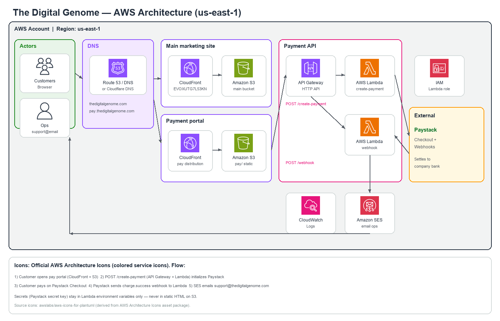
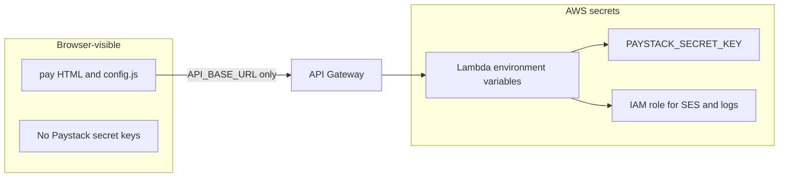

# The Digital Genome

Marketing site and Paystack payment portal for **The Digital Genome** — bioinformatics training and genomic analysis services.

| Surface | URL (target) | Role |
|---------|----------------|------|
| Main site | [https://thedigitalgenome.com](https://thedigitalgenome.com) | Marketing, enquire, quote, contact |
| Payment portal | [https://d2quxkjjff91j.cloudfront.net](https://d2quxkjjff91j.cloudfront.net/) (temp; later `pay.thedigitalgenome.com`) | Programme selection + Paystack Checkout |
| Support | [support@thedigitalgenome.com](mailto:support@thedigitalgenome.com) | Ops, refunds, payment plans |

---

## Contents

- [Overview](#overview)
- [Training programmes (v1 pricing)](#training-programmes-v1-pricing)
- [AWS architecture](#aws-architecture)
- [Payment sequence](#payment-sequence)
- [Repository structure](#repository-structure)
- [Local preview](#local-preview)
- [Deployment](#deployment)
- [Security notes](#security-notes)
- [Related docs](#related-docs)

---

## Overview

This repository contains:

1. **Static marketing website** — HTML/CSS/JS, deployed to **Amazon S3 + CloudFront**.
2. **Separate payment frontend** (`pay/`) — programme cards, refund policy, success/cancel pages.
3. **Serverless payment API** (`backend/`) — two **AWS Lambda** functions behind **API Gateway**, integrating **Paystack** and notifying ops via **Amazon SES**.

Enquiry and custom analysis quotes stay on the main site (Google Forms / WhatsApp / Formspree). **Card payments only happen on the payment portal → Paystack.**

---

## Training programmes (v1 pricing)

| Programme | Duration | Fee (USD) |
|-----------|----------|-----------|
| Beginner | 4 weeks | $100 |
| Intermediate | 8 weeks | $250 |
| Advanced | 6 months | $500 |

Prices are enforced **server-side** in `backend/src/programmes.js` (amounts in cents). The browser cannot set the charge amount.

---

## AWS architecture

### System design (official AWS Architecture Icons)



Diagram icons are the **official coloured AWS Architecture Icons** (sourced via [awslabs/aws-icons-for-plantuml](https://github.com/awslabs/aws-icons-for-plantuml), derived from the [AWS Architecture Icons](https://aws.amazon.com/architecture/icons/) asset package). Individual icon files live in [`docs/architecture/icons/`](docs/architecture/icons/).

### Services used

| Icon | AWS service | Role in this project |
|------|-------------|----------------------|
|  | **Amazon CloudFront** | CDN for main site and pay portal |
|  | **Amazon S3** | Static hosting origin (main + pay buckets) |
|  | **Amazon API Gateway** | HTTP API: `/create-payment`, `/webhook` |
|  | **AWS Lambda** | `create-payment` and `webhook` handlers |
|  | **Amazon SES** | Email payment alerts to support |
|  | **Amazon CloudWatch** | Lambda logs |
|  | **Amazon Route 53** (or external DNS) | `thedigitalgenome.com` / `pay.` records |
|  | **AWS IAM** | Lambda execution role (logs + SES) |

**External (non-AWS):** Paystack — hosted Checkout, webhooks, and bank settlements.

### Component responsibilities

| Component | Responsibility |
|-----------|----------------|
| **S3 + CloudFront (main)** | Host marketing pages; CI deploy on push to `main` |
| **S3 + CloudFront (pay)** | Host payment UI only; no secrets in static files |
| **API Gateway** | Public HTTPS entry for `/create-payment` and `/webhook` |
| **Lambda `create-payment`** | Map programme → amount; call Paystack Initialize Transaction; return `authorization_url` |
| **Lambda `webhook`** | Verify Paystack HMAC signature; on `charge.success` email ops via SES |
| **SES** | Send notification to `support@thedigitalgenome.com` |
| **Paystack** | PCI checkout, settlements to company bank, customer receipts |
| **DNS** | Apex → main CloudFront; `pay` → pay CloudFront (ACM cert in `us-east-1`) |

### Trust boundaries



- **Never** put `sk_test_` / `sk_live_` in `pay/` or the main site.
- Programme prices are trusted only from Lambda (`programmes.js`), not from the client.

---

## Payment sequence

```mermaid
sequenceDiagram
  actor Customer
  participant Main as MainSite
  participant PayUI as PayPortal
  participant APIGW as APIGateway
  participant Create as CreatePaymentLambda
  participant Paystack
  participant Hook as WebhookLambda
  participant SES as AmazonSES
  actor Ops as SupportOps

  Customer->>Main: Browse or enquire
  Customer->>Main: Click Make Payment
  Main->>PayUI: Open pay.thedigitalgenome.com
  Customer->>PayUI: Choose programme and email
  PayUI->>APIGW: POST /create-payment
  APIGW->>Create: Invoke
  Create->>Create: Lookup amount server-side
  Create->>Paystack: Initialize transaction
  Paystack-->>Create: authorization_url
  Create-->>PayUI: Return checkout URL
  PayUI->>Paystack: Redirect to Checkout
  Customer->>Paystack: Complete payment
  Paystack->>PayUI: Redirect success.html
  Paystack->>APIGW: POST /webhook charge.success
  APIGW->>Hook: Invoke
  Hook->>Hook: Verify x-paystack-signature
  Hook->>SES: SendEmail
  SES->>Ops: Payment notification
  Note over Ops,Customer: Ops sends Zoom or cohort access manually
```

**Enrolment rule:** paid (webhook confirmed) → access. Enquiry form alone does not enrol. Certificates require payment + completion. Refunds follow the policy on the payment page.

---

## Repository structure

```text
TheDG_1/
|-- index.html                 # Main marketing site
|-- styles.css
|-- script.js
|-- assets/                    # Logo, images, curriculum PDFs
|-- pay/                       # Payment portal (static)
|   |-- index.html             # Programmes + refund policy
|   |-- success.html
|   |-- cancel.html
|   |-- config.js              # API_BASE_URL (no secrets)
|   |-- pay.js
|   `-- styles.css
|-- backend/                   # AWS Lambda source
|   |-- src/
|   |   |-- createPayment.js   # POST /create-payment
|   |   |-- webhook.js         # POST /webhook
|   |   |-- programmes.js      # $100 / $250 / $500
|   |   |-- paystack.js
|   |   |-- verifyPaystack.js
|   |   |-- email.js           # SES
|   |   `-- http.js
|   |-- env.example
|   `-- package.json
|-- docs/
|   |-- PAYMENTS-DEPLOY.md     # AWS + Paystack deploy runbook
|   `-- architecture/
|       |-- aws-architecture.png
|       `-- icons/             # Official AWS coloured icons
|-- .github/
|   |-- workflows/
|   |   |-- deploy.yml         # Main site -> S3 + CloudFront
|   |   `-- deploy-pay.yml     # Optional pay site deploy
|   |-- iam-deploy-policy.json
|   |-- iam-pay-lambda-policy.json
|   `-- iam-pay-deploy-policy.example.json
`-- README.md
```

---

## Local preview

**Main site**

```bash
# from repo root
python3 -m http.server 8000
# open http://localhost:8000
```

**Payment portal**

```bash
cd pay
python3 -m http.server 8080
# open http://localhost:8080
```

Pay buttons stay disabled until `pay/config.js` has a real `API_BASE_URL` pointing at API Gateway.

**Backend zips**

```bash
cd backend
npm install
npm run zip:create-payment
npm run zip:webhook
```

---

## Deployment

| Target | How |
|--------|-----|
| Main site | GitHub Actions [`.github/workflows/deploy.yml`](.github/workflows/deploy.yml) on push to `main` |
| Pay site | Create S3 + CloudFront first, then optional [`.github/workflows/deploy-pay.yml`](.github/workflows/deploy-pay.yml) |
| Lambdas + API + SES + Paystack webhook | Follow **[`docs/PAYMENTS-DEPLOY.md`](docs/PAYMENTS-DEPLOY.md)** |

`deploy-pay.yml` only uploads static files to an **existing** bucket. It does **not** create AWS infrastructure. Create infra using the payments deploy guide, then optionally use the workflow for updates.

Suggested region: **`us-east-1`** (matches existing main-site resources).

**Existing main-site references (from IAM policy):**

- S3: `thedigitalgenome-471112990922-us-east-1-an`
- CloudFront: `EVOXUTG7L53KN`

Payment portal uses a **separate** bucket and distribution (create during deploy runbook).

---

## Security notes

- Store Paystack secrets only in **Lambda environment variables** (or Secrets Manager).
- Webhook rejects requests with invalid `x-paystack-signature` (HMAC SHA512).
- CORS: restrict `ALLOWED_ORIGIN` to the pay portal origin(s) in production.
- SES: verify sender identity; exit sandbox before sending to arbitrary customers (ops inbox can be verified first).
- Do not commit `.env`, live keys, or `backend/dist/` secrets.

---

## Related docs

- **[docs/PAYMENTS-DEPLOY.md](docs/PAYMENTS-DEPLOY.md)** — full AWS Console / Paystack setup checklist  
- [Paystack test payments](https://paystack.com/docs/payments/test-payments/)  
- [Paystack webhooks](https://paystack.com/docs/payments/webhooks/)  
- [AWS Architecture Icons](https://aws.amazon.com/architecture/icons/)  

---

## License / contact

Business site for The Digital Genome.  
Support: [support@thedigitalgenome.com](mailto:support@thedigitalgenome.com)
