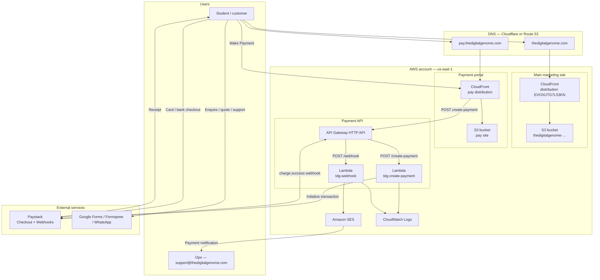
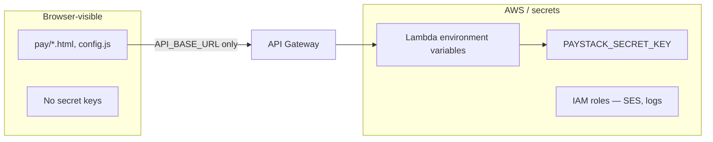

# The Digital Genome

Marketing site and Paystack payment portal for **The Digital Genome** — bioinformatics training and genomic analysis services.

| Surface | URL (target) | Role |
|---------|----------------|------|
| Main site | [https://thedigitalgenome.com](https://thedigitalgenome.com) | Marketing, enquire, quote, contact |
| Payment portal | [https://pay.thedigitalgenome.com](https://pay.thedigitalgenome.com) | Programme selection + Paystack Checkout |
| Support | [support@thedigitalgenome.com](mailto:support@thedigitalgenome.com) | Ops, refunds, payment plans |

---

## Contents

- [Overview](#overview)
- [Training programmes (v1 pricing)](#training-programmes-v1-pricing)
- [AWS architecture](#aws-architecture)
- [Payment sequence](#payment-sequence)
- [Repository structure](#repository-structure)
- [Local preview](#local-preview)
- [Deployment](#deployment)
- [Security notes](#security-notes)
- [Related docs](#related-docs)

---

## Overview

This repository contains:

1. **Static marketing website** — HTML/CSS/JS, deployed to **Amazon S3 + CloudFront**.
2. **Separate payment frontend** (`pay/`) — programme cards, refund policy, success/cancel pages.
3. **Serverless payment API** (`backend/`) — two **AWS Lambda** functions behind **API Gateway**, integrating **Paystack** and notifying ops via **Amazon SES**.

Enquiry and custom analysis quotes stay on the main site (Google Forms / WhatsApp / Formspree). **Card payments only happen on the payment portal ? Paystack.**

---

## Training programmes (v1 pricing)

| Programme | Duration | Fee (USD) |
|-----------|----------|-----------|
| Beginner | 4 weeks | $100 |
| Intermediate | 8 weeks | $250 |
| Advanced | 6 months | $500 |

Prices are enforced **server-side** in `backend/src/programmes.js` (amounts in cents). The browser cannot set the charge amount.

---

## AWS architecture

### High-level system design



### Component responsibilities

| Component | Responsibility |
|-----------|----------------|
| **S3 + CloudFront (main)** | Host marketing pages; CI deploy on push to `main` |
| **S3 + CloudFront (pay)** | Host payment UI only; no secrets in static files |
| **API Gateway** | Public HTTPS entry for `/create-payment` and `/webhook` |
| **Lambda `create-payment`** | Map programme ? amount; call Paystack Initialize Transaction; return `authorization_url` |
| **Lambda `webhook`** | Verify Paystack HMAC signature; on `charge.success` email ops via SES |
| **SES** | Send notification to `support@thedigitalgenome.com` |
| **Paystack** | PCI checkout, settlements to company bank, customer receipts |
| **DNS** | Apex ? main CloudFront; `pay` ? pay CloudFront (ACM cert in `us-east-1`) |

### Trust boundaries



- **Never** put `sk_test_` / `sk_live_` in `pay/` or the main site.
- Programme prices are trusted only from Lambda (`programmes.js`), not from the client.

---

## Payment sequence

```mermaid
sequenceDiagram
  actor User as Customer
  participant Main as Main site<br/>CloudFront + S3
  participant PayUI as Pay portal<br/>CloudFront + S3
  participant API as API Gateway
  participant Create as Lambda<br/>create-payment
  participant PS as Paystack
  participant Hook as Lambda<br/>webhook
  participant SES as Amazon SES
  actor Ops as support@

  User->>Main: Browse / Enquire
  User->>Main: Click Make Payment
  Main->>PayUI: Navigate to pay.thedigitalgenome.com
  User->>PayUI: Choose programme + email
  PayUI->>API: POST /create-payment
  API->>Create: Invoke
  Create->>Create: Lookup amount (server-side)
  Create->>PS: Initialize transaction
  PS-->>Create: authorization_url
  Create-->>PayUI: JSON url
  PayUI->>PS: Redirect to Checkout
  User->>PS: Complete payment
  PS->>PayUI: Redirect success.html
  PS->>API: POST /webhook charge.success
  API->>Hook: Invoke
  Hook->>Hook: Verify x-paystack-signature
  Hook->>SES: SendEmail
  SES->>Ops: Payment notification
  Note over Ops,User: Ops sends Zoom / cohort access manually
```

**Enrolment rule:** paid (webhook confirmed) ? access. Enquiry form alone does not enrol. Certificates require payment + completion. Refunds follow the policy on the payment page.

---

## Repository structure

```text
TheDG_1/
??? index.html                 # Main marketing site
??? styles.css
??? script.js
??? assets/                    # Logo, images, curriculum PDFs
??? pay/                       # Payment portal (static)
?   ??? index.html             # Programmes + refund policy
?   ??? success.html
?   ??? cancel.html
?   ??? config.js              # API_BASE_URL (no secrets)
?   ??? pay.js
?   ??? styles.css
??? backend/                   # AWS Lambda source
?   ??? src/
?   ?   ??? createPayment.js   # POST /create-payment
?   ?   ??? webhook.js         # POST /webhook
?   ?   ??? programmes.js      # $100 / $250 / $500
?   ?   ??? paystack.js
?   ?   ??? verifyPaystack.js
?   ?   ??? email.js           # SES
?   ?   ??? http.js
?   ??? env.example
?   ??? package.json
??? docs/
?   ??? PAYMENTS-DEPLOY.md     # Step-by-step AWS + Paystack deploy
??? .github/
?   ??? workflows/
?   ?   ??? deploy.yml         # Main site ? S3 + CloudFront
?   ?   ??? deploy-pay.yml     # Optional pay site deploy
?   ??? iam-deploy-policy.json
?   ??? iam-pay-lambda-policy.json
?   ??? iam-pay-deploy-policy.example.json
??? README.md
```

---

## Local preview

**Main site**

```bash
# from repo root
python3 -m http.server 8000
# open http://localhost:8000
```

**Payment portal**

```bash
cd pay
python3 -m http.server 8080
# open http://localhost:8080
```

Pay buttons stay disabled until `pay/config.js` has a real `API_BASE_URL` pointing at API Gateway.

**Backend zips**

```bash
cd backend
npm install
npm run zip:create-payment
npm run zip:webhook
```

---

## Deployment

| Target | How |
|--------|-----|
| Main site | GitHub Actions [`.github/workflows/deploy.yml`](.github/workflows/deploy.yml) on push to `main` |
| Pay site | Create S3 + CloudFront, then optional [`.github/workflows/deploy-pay.yml`](.github/workflows/deploy-pay.yml) |
| Lambdas + API + SES + Paystack webhook | Follow **[`docs/PAYMENTS-DEPLOY.md`](docs/PAYMENTS-DEPLOY.md)** |

Suggested region: **`us-east-1`** (matches existing main-site resources).

**Existing main-site references (from IAM policy):**

- S3: `thedigitalgenome-471112990922-us-east-1-an`
- CloudFront: `EVOXUTG7L53KN`

Payment portal uses a **separate** bucket and distribution (create during deploy runbook).

---

## Security notes

- Store Paystack secrets only in **Lambda environment variables** (or Secrets Manager).
- Webhook rejects requests with invalid `x-paystack-signature` (HMAC SHA512).
- CORS: restrict `ALLOWED_ORIGIN` to the pay portal origin(s) in production.
- SES: verify sender identity; exit sandbox before sending to arbitrary customers (ops inbox can be verified first).
- Do not commit `.env`, live keys, or `backend/dist/` secrets.

---

## Related docs

- **[docs/PAYMENTS-DEPLOY.md](docs/PAYMENTS-DEPLOY.md)** — full AWS Console / Paystack setup checklist  
- [Paystack test payments](https://paystack.com/docs/payments/test-payments/)  
- [Paystack webhooks](https://paystack.com/docs/payments/webhooks/)  

---

## License / contact

Business site for The Digital Genome.  
Support: [support@thedigitalgenome.com](mailto:support@thedigitalgenome.com)
